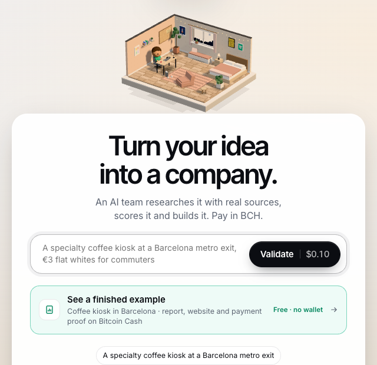
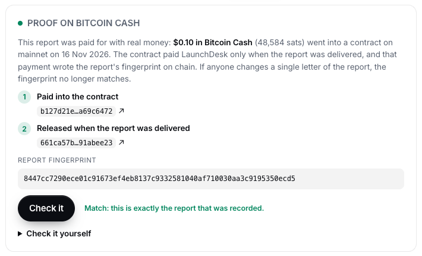

# LaunchDesk


**[Live demo](https://launchdesk-bch.onrender.com)** · <!-- SLIDES_URL -->**[Slides](https://docs.google.com/presentation/d/14SM9PMZJ2VYIJ2yJ_TzGsC_Pdk8lL67EFjpPrYioalM/edit?usp=sharing)** · <!-- BUIDL_URL -->**[Finished example](https://launchdesk-bch.onrender.com/p/ex-coffee-bcn)** · **[Video (2 min)](https://youtu.be/I7OzmWD8n7Y)** · **[BUIDL](https://dorahacks.io/build/51438)**

**Your startup team, for cents. Paid in BCH.**



Pitch your idea. A team of AI specialists checks it against real sources, then makes a logo, a live website and a
30-day launch plan. You pay a small amount of Bitcoin Cash for each step (BCH BLAZE launch price until 30 Nov 2026:
10¢ for the report, 50¢ for the launch kit), and the report payment is held in a contract until it is delivered.

Built for **BCH BLAZE 2026** (Mainnet track).

**Live demo: https://launchdesk-bch.onrender.com**. No wallet needed to look around: tap **"See a finished company"**.

## Proven on Bitcoin Cash mainnet

On 16 Nov 2026 we ran one real order through the escrow contract. It was paid from the Selene wallet over
WizardConnect, for a coffee kiosk idea in Barcelona.

| Step | Transaction | What happened |
|---|---|---|
| Payment into the contract | [`b127d21e…6472`](https://blockchair.com/bitcoin-cash/transaction/b127d21e7122fe0201c88aeeee39c1d0b85bd0cceb821673b2e9b6e0a69c6472) | 48,584 sats (10¢) to this order's own contract address, plus an `OP_RETURN` tag `LD1:<project>:validate` |
| Release after delivery | [`661ca57b…ee23`](https://blockchair.com/bitcoin-cash/transaction/661ca57bd66b7bbc61667724fb104c506b263f68474d6a068a97b5ba91abee23) | 47,985 sats to the merchant (fee 599 sats), plus `OP_RETURN "LD1" 8447cc72…50ecd5`, the SHA-256 of the delivered report |
| Refund drill: payment | [`16106ef3…1b5a`](https://blockchair.com/bitcoin-cash/transaction/16106ef3936c7f87c21a86ca727fc173fa98923fb1d5578603a9944455081b5a) | 21 Nov 2026: 50,000 sats from Selene into a second order's contract (same contract, same production key) |
| Refund drill: too early | rejected by the network | Broadcast before 6 blocks: nodes refused it with `non-BIP68-final`. The timeout is enforced by Bitcoin Cash itself, not by us |
| Refund drill: refund | [`33219ae2…e4d8`](https://blockchair.com/bitcoin-cash/transaction/33219ae2f3831e0ac907e7635936379db7621caf965531c47ddb1e9aa04ee4d8) | After 6 blocks: 49,612 sats back to the customer's address (fee 388 sats). Built with `contracts/refund-offline.ts`, no key and no server |



- The contract address was `bitcoincash:pd092n6eyfv78vms0eed9f463smzmzzpqu5lmqfjnky7fy6wv3kv7azv40dvw` (P2SH32) for the release, and `bitcoincash:p0rxfcq9tnzg299m66ys8as58tl2yeuprzr0zdmy4cgjc3s73yayk0ranweju` for the refund drill. So both ways out of the contract have run on mainnet.
- The fingerprint shown on the report page equals the one on chain. The page's "Check it" button said "Match".
- The contract is [`contracts/LaunchDeskEscrow.cash`](contracts/LaunchDeskEscrow.cash).
- [SECURITY.md](SECURITY.md) explains in plain words what we can and cannot do with your money. It includes the honest
  caveat: the fingerprint proves which report we delivered, not that the report is good.

## What a judge sees (about 2 minutes)

0. No wallet? Open https://launchdesk-bch.onrender.com and tap **"See a finished company"** under the idea box. It opens a real run (a coffee kiosk in
   Barcelona, paid 10¢ on mainnet) on its report, the proof panel and its launch kit, in about 5 seconds.
1. Open the demo at https://launchdesk-bch.onrender.com and type a business idea.
2. Pay **10¢** (launch price until 30 Nov 2026, then $1; see [Prices](#prices)) from a WizardConnect wallet (Selene, Cashonize, Paytaca). The money goes into a contract for this
   order only. It is held there, not paid to us yet.
3. The team writes the report while you watch, with real source links. A full run took 78–102 seconds in our live
   tests.
4. When the report is ready, the server releases the payment and writes the report's fingerprint on chain. The
   **"Proof on Bitcoin Cash"** panel links to the transaction and has a **"Check it"** button.
5. Optional: the **50¢ launch kit** (launch price until 30 Nov 2026, then $5) (logo options, a live website, a 30-day plan). This one is a plain payment, not
   escrow.

If no report arrives, the contract lets anyone send the money back to the paying wallet about one hour (6 blocks)
after the payment confirms. No signature is needed. Our server sends that refund by itself while it is running; if it
is down, anyone can still send it with `contracts/refund-offline.ts` and the "Download refund details" file from the
proof panel (public values only).

## How the escrow works

```
customer wallet ──pay──▶ order contract (one P2SH32 address per order)
                           ├─ release(): LaunchDesk key + report signature
                           │             → merchant address (minus a fee of at most 2,000 sats)
                           │             + OP_RETURN "LD1" <sha256(report)>
                           └─ refund():  no signature, only after 6 blocks
                                         → the customer's own address (minus a fee of at most 2,000 sats)
```

No other spend is valid. That stays true even for someone holding the LaunchDesk keys.

**One key today, honestly.** In production `ESCROW_ORACLE_WIF` is not set, so the report-signature key is the same
key as the release key. The release signature already commits to the `OP_RETURN` output, so today the data signature
adds no second factor. It is a hook for a future independent checker (a separate key, kept off the web host), and
the contract already supports it. What protects the customer is the contract itself: the money can only go to the
merchant with the report fingerprint on chain, or back to the customer after the timeout.

## Tests

`npm test` needs no API key and no wallet. Run it with `MOCK_AI=1 BCH_USD_FIXED=400`: the AI runs on sample data, the BCH
price is fixed, and nothing goes to the network. Without `BCH_USD_FIXED`, a few launch kit tests ask a public BCH price feed
once; they pass offline too.

On 20 Nov 2026 `npm test` printed 183 `node:test` results, all passing (15 + 14 + 41 escrow, then 113 in the last
batch), plus script-style checks that stop at the first failure. Some log lines show API errors such as "credit
balance is too low": `test/brake.test.ts` fakes them on purpose to test the spend brake. No real API call is made.

- **70 escrow tests.** Every transaction is checked by the real BCH virtual machine (libauth, through CashScript's
  `MockNetworkProvider`):
  - `test/escrow.test.ts`: 15 tests of the normal paths and the main rejections, plus a $5-sized order;
  - `test/escrow-flow.test.ts`: 14 end-to-end tests through the real app: quote, pay, run, release, refund drill, a
    paid report the AI could not write (refunded, never delivered), a late report, a wallet payment the browser never reported back, a re-quote by someone who is not the owner
    (refused), and 5 stray-coin cases (an underpayment, a second payment, a payment to a stale quote, and others: each goes back
    through the keyless refund and never starts a run);
  - `test/escrow-attacks.test.ts`: 41 named attacks and controls. They include paying the wrong address, a forged or
    replayed report signature, a fee 1 sat over the limit, extra outputs or inputs, a tampered `OP_RETURN`, token
    minting, an early refund, a refund to someone else, and merging two payments.
- **Mutation check (`npm run mutate`).** `scripts/mutate-contract.mjs` removes each of the contract's 15 `require`
  lines in turn, recompiles it with cashc, and runs the attack tests against that weaker contract, in a temporary
  copy (the repo is never changed). It prints a table: 15 of 15 mutants are caught by at least one attack test.
- **Prices (`test/pricing.test.ts`):** the launch-price switch by date (with an injected clock), `/api/config`, quotes
  before and after the switch (an open quote keeps its amount), the home page note and the price formatting (10¢,
  50¢, $1, $5).
- **Other areas:** payments, report schema, the mock flow, rate limits, launch kit, verdicts, offices and the website
  generator (51 `node:test` cases in `test/site*.test.ts`), logo options (`test/brand.test.ts`), report quality rules (`test/quality.test.ts`), plus script-style
  checks.

To run only the attack tests:

```bash
node_modules/.bin/tsx --test test/escrow-attacks.test.ts
```

## Architecture

- **`web/`**: a Vite front end. `web/proto/` is the app with the 3D office. Payments are built in the browser from
  the wallet's coins and signed by the wallet over WizardConnect.
- **`server/`**: a Hono API on Node 22, with libSQL (Turso in production).
  - `chain.ts` checks and broadcasts payments through public Electrum servers.
  - `escrow/` holds the contract helpers, the order store, and a watcher that releases or refunds.
  - `v7*` and `report-v7.ts` run the sourced report, and `brand/`, `site/` and `marketing/` make the launch kit.
- **`contracts/`**: the CashScript escrow contract, its compiled artifact, a key generator and an offline refund
  tool.
- The AI is Anthropic's Claude. With `MOCK_AI=1`, or with no key, the app runs on sample data and payments are
  turned off.

## Prices

| Step | BCH BLAZE launch price, until 30 Nov 2026 23:59:59 (Madrid) | Regular price, from 1 Dec 2026 |
|---|---|---|
| Research report | 10¢ | $1 |
| Launch kit (logo, website, 30-day plan) | 50¢ | $5 |
| Office tasks | from 2¢, priced per task (`server/offices/catalog.ts`) | unchanged |

- Every price comes from the server config (`PRICE_*` and `LAUNCH_PRICE_UNTIL`, see [Deploy](#deploy-render--turso)). One
  function, `server/pricing.ts`, decides the price of each step at the moment of the request, so the switch at midnight
  needs no restart or redeploy. Quotes, escrow orders, recorded payments, the home page and the app all use it.
- A price quote already issued keeps its amount for its 15 minutes, even across the switch: the wallet is never asked
  for a different amount than the one it was shown.
- `GET /api/config` returns `prices` (today's), `regularPrices`, `launchPrice` (true while the launch price applies)
  and `launchPriceUntil`.
- While the launch price applies, the app shows one short line next to the report and kit prices: "BLAZE launch price ·
  from 1 Dec: $1 report · $5 kit". After it, that line disappears and the regular prices show.
- The AI spend caps do not change with the price (`REPORT_CAP_USD`, `KIT_SPEND_CAP_CENTS` = 45¢): every step costs us
  less in AI than it is sold for, at the launch price and after it. The escrow contract has no upper limit on the
  amount, so a $1 order works like a 10¢ one.

## Payments (without escrow)

- The browser builds the transaction from the wallet's coins, and the wallet signs it over WizardConnect.
- The transaction pays the merchant address. It carries an `OP_RETURN` tag `LD1:<project>:<stage>` that binds it to
  one order.
- The server decodes it, checks the amount and the tag, broadcasts it, and only then runs the AI. Each transaction can
  be used once.
- With `ESCROW=1` (server) and `VITE_ESCROW=1` (browser build), the report payment is made into the escrow contract
  instead. Both flags must be on together.

## Run locally

```bash
cp .env.example .env   # MOCK_AI=1 runs without an API key
npm install
npm run dev            # web on :5173, API on :8790
MOCK_AI=1 BCH_USD_FIXED=400 npm test   # no network, no secrets
npm run typecheck
npm run build
```

- `/` is the app (`web/index.html` → `web/proto/main.ts`).
- `/s/<slug>` (the generated public site) and `/r/<id>` (a shared report) are rendered by `web/classic.html`
  (`web/src/main.ts`). `/proto.html` is an alias of `/`.
- To point the dev proxy at another API port, use `VITE_API=http://localhost:<port> npx vite`.
- `DEV_SKIP_PAYMENT=1` runs the flow without paying, on localhost only. It is ignored when `NODE_ENV=production`.
- `npm run contracts` recompiles the contract. Do not change it while orders are open: each order's address depends
  on the exact compiled code.

## Deploy (Render + Turso)

1. **Turso:** run `turso db create launchdesk`, then `turso db show launchdesk --url` (gives `libsql://…`) and
   `turso db tokens create launchdesk`. The schema is created on boot.
2. **Render:** New → Blueprint → this repo. `render.yaml` defines one Node web service, `launchdesk-bch`: build with
   `npm ci --include=dev && npm run build`, start with `npm start`, health check at `/healthz`.
3. Fill in the secret env vars Render asks for:

| Variable | Value |
|---|---|
| `ANTHROPIC_API_KEY` | your Anthropic key (without it, the AI runs in mock mode) |
| `MERCHANT_ADDRESS` | the `bitcoincash:q…` address that receives payments |
| `DATABASE_URL` | the Turso `libsql://…` URL |
| `DATABASE_TOKEN` | the Turso token |
| `PUBLIC_URL` | the public origin, with no trailing slash |
| `ESCROW`, `VITE_ESCROW` | `1` for both, or leave both unset |
| `ESCROW_WIF` | the escrow server key (make one with `node contracts/keygen.mjs`; never commit it) |
| `NODE_ENV` | `production` (already set in `render.yaml`) |
| `VITE_SLIDES_URL`, `VITE_REPO_URL` | the slides and repo links in the hackathon banner (read at build time: rebuild after a change) |

Set in `render.yaml` (change them in Render's Environment tab if needed):

| Variable | Default | What it does |
|---|---|---|
| `DAILY_CAP_USD` | `10` | Spend brake: new paid runs pause for the rest of the UTC day once AI spend would pass this (`.env.example` uses `3` for local runs) |
| `PAUSE` | unset | Set to `1` to pause new paid runs at once. Sample runs and the finished examples keep working |
| `TRUST_PROXY_HOPS` | `2` in production | How many proxy hops (Render's edge) to skip in `X-Forwarded-For` when finding the visitor for rate limits |
| `TRUST_PROXY_SKIP_PRIVATE` | on in production | Drop private (internal) addresses from `X-Forwarded-For` first |
| `PRICE_VALIDATE_CENTS`, `PRICE_BUILD_CENTS` | `10`, `50` | The BCH BLAZE launch prices of the report and the Launch kit, in US cents, charged until `LAUNCH_PRICE_UNTIL`. Every quote and every price on the home page and in the app follow the price of the day (the page gets it from the server and `/api/config`); office task prices come from `server/offices/catalog.ts` |
| `PRICE_VALIDATE_REGULAR_CENTS`, `PRICE_BUILD_REGULAR_CENTS` | `100`, `500` | The regular prices ($1 report, $5 kit), charged from the second after `LAUNCH_PRICE_UNTIL` |
| `LAUNCH_PRICE_UNTIL` | `2026-11-30T23:59:59+01:00` | Last second of the launch price (ISO 8601 with an offset). No restart is needed when it passes |
| `RATE_LIMIT_RUN` | `10` | Per visitor: run or retry starts allowed per 10 minutes. Each paid step runs at most 3 times in all (first run plus retries) |
| `RATE_LIMIT_QUOTE` | `40` | Per visitor: new price quotes allowed per 10 minutes (each one reserves a unique QR amount for 24 h) |

To check a production build locally:

```bash
npm run build
NODE_ENV=production PORT=8899 DATABASE_URL=file:local.db npm start   # serves /, /s/<slug>, /r/<id>, /healthz
```

## Pre-existing work

The idea and a visual sketch existed before the hackathon. All the code in this repository is new, written during
BLAZE 2026. First commit: [`877ea57`](https://github.com/cesaralonsoo/launchdesk/commit/877ea57), 14 Nov 2026 20:20
(+01:00). The full history is public.

## Licence

MIT for this code. WizardConnect libraries are LGPL-3.0-or-later.
